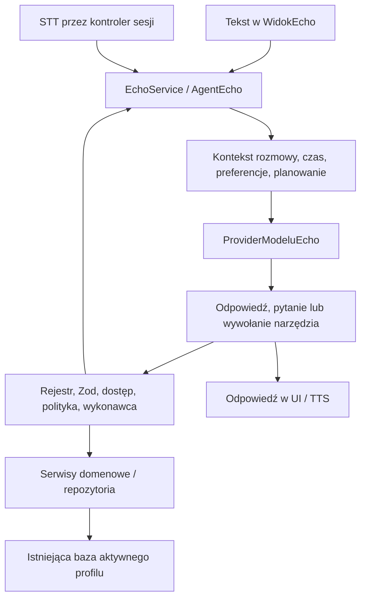

# Echo — aktualna mapa modułu

Stan zweryfikowany w kodzie 2026-11-10, na bazie lokalnego commita `7163d1d`. Dokument opisuje implementację, nie potwierdza konfiguracji produkcji, jakości konkretnego LLM ani działania fizycznego telefonu. Kolejne etapy: [UPGRADE_2026.md](UPGRADE_2026.md).

## Istniejące komponenty i przepływ

| Odpowiedzialność | Właściciel w kodzie |
|---|---|
| Wspólna sesja, ustawienia dostępu, kontrolery | `src/app/DostawcaSesjiEcho.tsx` |
| Rozmowa tekstowa, wyniki i potwierdzenia | `src/modules/echo/WidokEcho.tsx` |
| Fasada i agent loop | `src/services/EchoService.ts`, `src/services/echo/AgentEcho.ts` |
| Kontrakty modelu, decyzji, pamięci i planu | `src/services/echo/typyEcho.ts` |
| Narzędzia i kontrolowany zapis | `src/services/echo/NarzedziaEcho.ts`, `PolitykaDzialanEcho.ts`, `PlanWykonaniaEcho.ts` w tym samym katalogu |
| Kontekst i preferencje | `KontekstRozmowyEcho.ts`, `KontekstPlanowaniaEcho.ts`, `PamiecPreferencjiEcho.ts` w `src/services/echo/` |
| Głos i wake word | `KontrolerSesjiGlosowejEcho.ts`, `KontrolerWakeWordEcho.ts`, `SilnikWakeWordEcho.ts` w `src/services/echo/`; mosty w `src/platform/` |
| Backend modelu | `server/model-echo.ts`, `server/config.ts`, routing w `server/serwer.ts` |

Agent ma domyślnie sześć kroków i limit 15 sekund na odpowiedź providera, z anulowaniem przez `AbortSignal`. Jest jeden agent dla tekstu i transkrypcji. Plan wykonania, ponowna kontrola stanu i potwierdzenie oczekującego wywołania już istnieją — nie budować ich ponownie.

## Modele i źródła danych

- `ProviderModeluEcho` jest wymienny przez `OpcjeAgentaEcho.provider`. Metoda strumieniowa jest opcjonalnym kontraktem; obecna ścieżka żądania modelu nie strumieniuje.
- Bez adresu API synchronizacji agent wybiera `LokalnySemantycznyProviderEcho`: ograniczoną, deterministyczną obsługę języka. To nie model neuronowy ani gwarancja rozumienia dowolnego polskiego zdania.
- Z adresem API wybierany jest `LokalnyModelProviderEcho`. Wysyła strukturalne zadanie przez `POST /api/echo/model`, z sesją i CSRF. Niektóre istniejące ścieżki tworzenia nadal obsługuje lokalny provider semantyczny wewnątrz tego adaptera.
- Backend wymaga pary `ECHO_MODEL_URL` / `ECHO_MODEL`, adresu loopback i limitu `ECHO_MODEL_TIMEOUT_MS`. Wysyła żądanie zgodne z Ollama (`stream: false`, schemat JSON), nie instaluje modelu. Kod nie wskazuje jednego faktycznie uruchomionego modelu. Sama nazwa trybu `pelny_agent` nie dowodzi jego dostępności.
- `POST /api/echo/message` jest odrębnym kontraktem wiadomości serwera, nie trasą używaną przez klientowy adapter modelu. Nie należy przenosić agent loop na serwer w ramach kosmetyki lub wymiany STT.
- Dane pochodzą z aktywnego profilu i istniejących serwisów. Rejestr obejmuje m.in. zadania, przypomnienia, projekty, Planer, nawyki, zakupy, finanse, samochód, zdrowie i wiedzę. `search_knowledge` wyszukuje ograniczone projekcje notatek, dokumentów, pomysłów i kontaktów; `list_calendar` dotyczy bloków Planera.
- Czas, strefa oraz kontekst planowania są budowane jawnie. Model dostaje także historię, preferencje i wyniki narzędzi — nie tylko ostatni wynik. Treści rekordów są danymi, nie instrukcjami wykonania.
- `current_external_data` jest placeholderem: zwraca brak skonfigurowanego providera. Włączenie ustawienia internetu nie dodaje wyszukiwarki.

Konfiguracja lokalnego modelu i transport: [echo-model-lokalny.md](echo-model-lokalny.md). Nie odczytuj prywatnego env ani danych rozmów tylko po to, by ustalić mapę architektury.

## Uprawnienia i działania

`DostawcaSesjiEcho` przekazuje wykonawcy kontrolę modułów z ustawień Echo oraz przełącznika internetu. `WykonawcaNarzedziEcho` sprawdza nazwę, schemat Zod, dostęp, ryzyko i aktualność danych, a następnie używa zamkniętych funkcji domenowych. Repozytoria i serwer mają dodatkowe kontrole profilu i prywatności. Nie zakładaj, że jeden przełącznik modułu zastępuje autoryzację wszystkich odczytów złożonego narzędzia.

Operacje niskiego ryzyka mogą wykonać się bez pytania; umiarkowane i wysokie wymagają potwierdzenia. Dawki leków korzystają z istniejącego `idWystapienia` i `zapiszStatusDawkiZApteczka`, z osobną zgodą na rozbieżność zapasu. Model nie ma dostępu do shella, SQL ani dowolnego JavaScript. Błąd nie może stać się komunikatem sukcesu ani powodem ponownego zapisu innym silnikiem.

Dziennik działań trafia do `dziennikEcho`; traktuj go jako prywatne dane, nie publiczną telemetrię. Rozszerzenia finansów i zdrowia wymagają własnych testów uprawnień, minimalizacji pól oraz aktualności stanu.

## Pamięć i przechowywanie

| Mechanizm istniejący | Trwałość i granice |
|---|---|
| `KontekstRozmowyEcho` | Pamięć obiektu: do 12 tur, 8 wyników, 12 encji, 6 intencji; przechowuje też bieżący plan i doprecyzowanie. Starsze tury są pomijane, bez automatycznego streszczania przez LLM |
| Wiadomości w `DostawcaSesjiEcho` | Stan React. Limit kontekstu agenta nie jest limitem długości listy wiadomości UI; brak trwałego archiwum rozmów |
| `MagazynPreferencjiEcho` | Istniejąca tabela `pamiecEcho`, wyszukiwanie tekstowe preferencji i deduplikacja; nie baza wektorowa. Odczyt odtwarza `pewnosc: 1`; nie należy przedstawiać tego jako zapisanej oceny modelu |
| Polityka pamięci | Ręczny zapis i jawna prośba są dopuszczone, propozycja Echo wymaga akceptacji. Automatycznie rozpoznawane preferencje obejmują ograniczone formy, np. „wolę…” |
| Backup / sync | Backup zawiera `pamiecEcho` i `dziennikEcho`. `KolejkaSynchronizacji.ts` wyklucza obie tabele z synchronizacji. Nie mylić tego z synchronizowanym stanem przypomnienia Echo P1 |

Uporządkowana reprezentacja danych już istnieje: `ZadanieModeluEcho`, migawka kontekstu, schematy narzędzi i ich wyniki. Rozwijaj przepływ **dane źródłowe → ograniczona projekcja → kontekst → decyzja → domena**, bez drugiej bazy i bez zmiany synchronizacji.

Eksport diagnostyczny JSON/Markdown to dopiero propozycja. Powinien działać na świadomie wybranym, domyślnie syntetycznym zakresie, bez treści zdrowotnych/finansowych, sekretów i identyfikatorów osób; zapisywać poza repo i umożliwiać podgląd przed zapisem. Istniejącego pełnego backupu nie wolno traktować jako bezpiecznego kontekstu dla agenta programistycznego. Ten etap nie dodaje eksportera ani RAG.

## Głos — implementacja a braki

| Mechanizm | Wdrożone w kodzie | Brak / ograniczenie |
|---|---|---|
| STT | Kontrakt `RozpoznawanieMowyEcho` w `GlosEchoService.ts`; Web Speech API; Android `EchoGlosPlugin.java`: `SpeechRecognizer`, `pl-PL`, częściowe wyniki, timeout, anulowanie | Obecny adapter jest wspólny z TTS. Brak gwarancji pracy offline |
| TTS | Kontrakt `SyntezaMowyEcho` w `GlosEchoService.ts`; Web `speechSynthesis`; Android `TextToSpeech`, polski język, zatrzymanie | Dostępność głosu zależy od systemu. Brak kolejki strumieniowego TTS |
| LLM | `ProviderModeluEcho`, provider semantyczny i adapter lokalnego modelu | Brak pomiarów wybranego modelu na docelowym sprzęcie; bieżąca odpowiedź modelu bez streamingu |
| VAD | Systemowe zdarzenia początku/końca mowy i timeouty w Android STT | Brak wymiennego VAD i strumienia PCM dla modeli. `onRmsChanged` nie publikuje amplitudy do UI |
| Wake word | `SilnikWakeWordEcho`, kontroler cyklu życia, Android Porcupine 4.0.2 | Wymaga klucza i `echo/hej_echo_android.ppn`; repo zawiera README zamiast modelu. Web zwraca niedostępność; brak dowodu gotowości prywatnego builda |
| Barge-in | `przerwijIMow()` oraz natywna próba przerwania przez rozpoznaną wypowiedź podczas TTS | To nie niezależny pełnodupleksowy tor VAD/AEC. Trzeba sprawdzić samowzbudzenie od głośnika, ciszę i restart na telefonie |

`KontrolerSesjiGlosowejEcho` już obsługuje kontynuację, częściową transkrypcję, fallback do ostatniej częściowej wypowiedzi przy wybranych cichych zakończeniach, doprecyzowanie, potwierdzenie, anulowanie i przejście aplikacji w tło. `KontrolerWakeWordEcho` zwalnia mikrofon przed uruchomieniem STT i zatrzymuje silnik na czas sesji. Nie wdrażać tych funkcji od nowa.

Systemowe STT może korzystać z serwera dostawcy: [Android SpeechRecognizer](https://developer.android.com/reference/android/speech/SpeechRecognizer), [Web SpeechRecognition](https://developer.mozilla.org/en-US/docs/Web/API/SpeechRecognition). Użyte API i kod nie wymuszają lokalności. Windows używa ścieżki webowej; dostępność Web Speech w WebView2 wymaga osobnego sprawdzenia.

Natywny wake word pobiera klucz z `BuildConfig`; ignorowanie env chroni źródła, lecz nie zapewnia tajności klucza w gotowym APK. Nie zmieniono kluczy, SDK ani sposobu dystrybucji.

## Stany — istniejące i prezentowane

Istnieją dwa różne kontrakty:

- `StanPracyEcho`: `gotowy`, `slucham`, `rozumiem`, `generuje`, `wykonuje`, `gotowe`; agent udostępnia callback `onZmianaStanu`.
- `StanSesjiGlosowejEcho`: `bezczynny`, `sluchanie`, `mowiUzytkownik`, `transkrypcja`, `myslenie`, `mowienie`, `oczekiwanie`, `oczekujeDoprecyzowania`, `oczekujePotwierdzenia`, `anulowanie`, `blad`.

`DostawcaSesjiEcho` podpina callback agenta. `AgregatorStanuEcho` w `src/services/echo/` rzutuje stan sesji, agenta, aktywność tekstową oraz wynik oczekującego potwierdzenia/doprecyzowania do jednego `StanPrezentacjiEcho`. To adapter prezentacji, a nie drugi kontroler cyklu operacji.

Reguły projekcji i priorytety:

| Stan prezentacji | Rzeczywiste źródło / warunek |
|---|---|
| Bezczynność | Sesja nieaktywna i brak aktywnego żądania tekstowego |
| Nasłuchiwanie | `sluchanie`, `mowiUzytkownik` lub cykl kontynuacji `oczekiwanie` |
| Rozpoznawanie | Zdarzenie `transkrypcja`; timeout nie jest rozpoznaniem |
| Przetwarzanie | Sesja `myslenie` albo aktywność agenta poza wywołaniem modelu |
| Oczekiwanie na potwierdzenie / doprecyzowanie | Stany kontrolera wynikające z odpowiedzi agenta |
| Generowanie odpowiedzi | Agent emituje `generuje` przed wywołaniem providera; bez postępu tokenów |
| Odtwarzanie głosu | Kontroler jest w `mowienie`; anulowanie ustawia `anulowanie` przed zatrzymaniem silnika |
| Anulowanie / błąd | Stany kończące sesję; po anulowaniu wraca aktywność tekstu lub bezczynność |

Kolejność przy równoczesnych zdarzeniach: błąd, anulowanie, potwierdzenie/doprecyzowanie, aktywny głos, tekst, bezczynność. Widok anuluje żądanie tekstowe po zmianie widoku lub przejściu aplikacji w tło. Numer sesji kontrolera odrzuca spóźnione wyniki; widok numeruje odczyty TTS, żeby zakończenie starszego odczytu nie nadpisało nowszego stanu. Webowe `mow()` kończy obietnicę po zatrzymaniu albo zastąpieniu syntezy.

Kontrakty `RozpoznawanieMowyEcho` i `SyntezaMowyEcho` wydzielają istniejące operacje, zachowując `utworzUslugeGlosuEcho`, bieżący adapter i konsumentów. Nie dodano dostawcy, silnika ani streamingu. Działanie poza atrapami testowymi wymaga osobnej weryfikacji sprzętowej.

## Proaktywność już dostępna

`PodsumowaniePoPracyService`, `SilnikPrzypomnien` i sekcja Dzisiaj realizują lokalne Echo P1: zadania pozostałe po pracy, ustawienia opóźnienia, wyciszenie, neutralny alarm, deduplikację oraz link `/dzisiaj?poPracy=YYYY-MM-DD`. Są też briefing i sugestie Pulpitu. Stan przypomnienia korzysta z istniejącego sync; lokalnego `zaplanowanoNa` nie przenosi się między urządzeniami. Szczegóły P1 pozostają w [ECHO_AGENT_ARCHITEKTURA.md](ECHO_AGENT_ARCHITEKTURA.md#echo-p1--podsumowanie-po-pracy).

Nie ma podstaw do deklarowania ogólnego, stale działającego autonomicznego asystenta. Web po zamknięciu i Android po force-stop mają ograniczenia systemowe; serwer Raspberry Pi nie zastępuje działającego klienta przypomnień.

## Rozbudowa i weryfikacja

Rozszerzenie zaczyna się od znalezienia narzędzia i publicznego serwisu danej domeny. Nowy wycinek dopisuje schemat, minimalną projekcję, przypisanie modułu, politykę i kontrolę aktualności oraz test zachowania. Nazwy istniejących narzędzi transportowych pozostają zgodne z kontraktem. Nie dodawać równoległego parsera, agenta ani bazy pamięci.

Najbliższe testy, dobierane do zmiany:

| Obszar | Zestawy |
|---|---|
| Agent / narzędzia / polityka | `src/services/echo/AgentEcho.test.ts`, `NarzedziaEcho.test.ts`, `AutonomiaEcho.test.ts`, `StanPrzedAkcjaEcho.test.ts`, `PlanWykonaniaEcho.test.ts` |
| Kontekst / pamięć / model | `PamiecPreferencjiEcho.test.ts`, `KontekstPlanowaniaEcho.test.ts`, `LokalnyModelProviderEcho.test.ts`, `RozmowaNaturalnaEcho.test.ts` w `src/services/echo/`; `server/model-echo.test.ts`, `server/serwer.test.ts` |
| Głos i aktywacja | `src/services/echo/KontrolerSesjiGlosowejEcho.test.ts`, `KontrolerWakeWordEcho.test.ts`; dodatkowo fizyczny Android i web/WebView2 |
| UI i proaktywność | `src/modules/echo/WidokEcho.test.ts`, `src/services/PodsumowaniePoPracyService.test.ts`, testy sekcji Dzisiaj i platformowych powiadomień |
| Dane i transport | `src/data/Repozytorium.test.ts`, `src/services/BackupService.test.ts`, `SyncEngine.test.ts` i testy dotkniętej domeny |

Przykład wąskiej regresji głosu: `npm test -- src/services/echo/KontrolerSesjiGlosowejEcho.test.ts src/services/echo/KontrolerWakeWordEcho.test.ts`. Testy z atrapami nie dowodzą jakości STT/TTS, polszczyzny LLM ani opóźnień sprzętu. Zmiana samego tego dokumentu wymaga kontroli odwołań i zgodności z kodem, bez uruchamiania silników głosu.

Materiały wcześniejszych etapów: [ECHO_AGENT_ARCHITEKTURA.md](ECHO_AGENT_ARCHITEKTURA.md) przechowuje decyzje projektowe i szczegóły P1; [VOICE_CHECKPOINT_2026-08-27.md](VOICE_CHECKPOINT_2026-08-27.md) jest snapshotem historycznym. Ich dawne listy brakujących funkcji nie zastępują aktualnej mapy powyżej.
